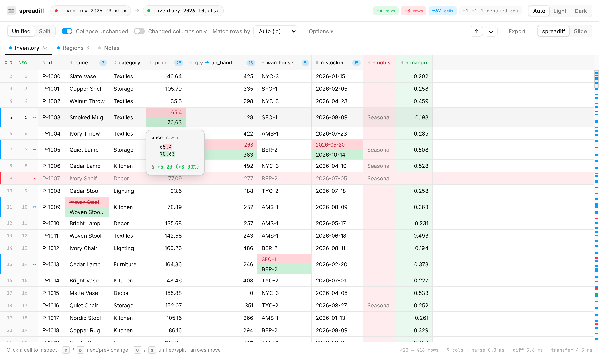
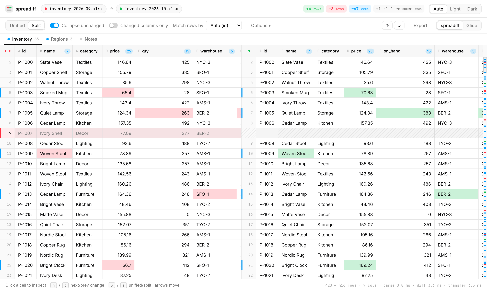
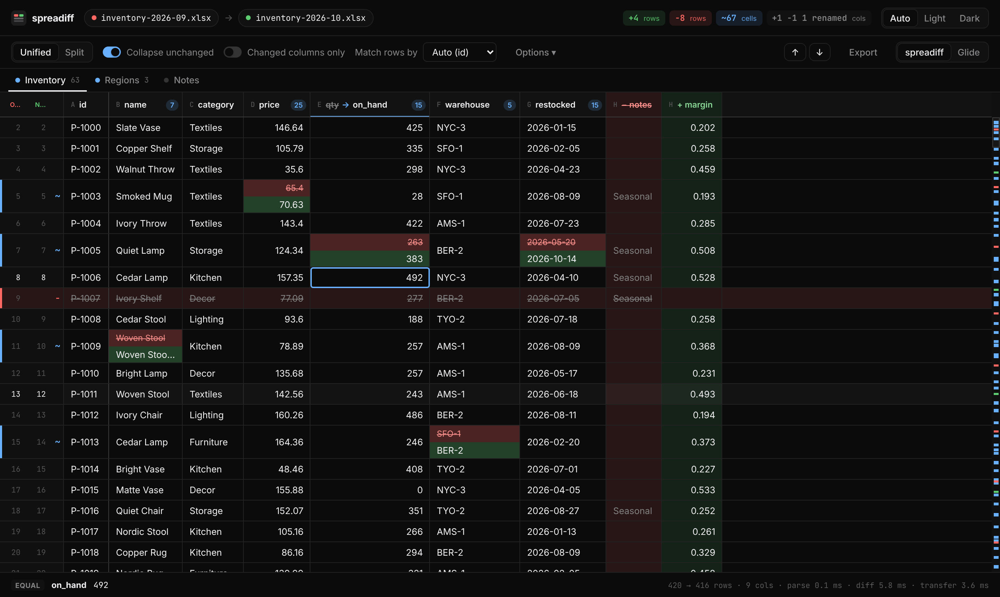
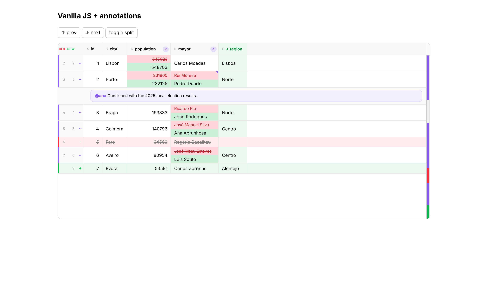

# spreadiff

Fast, good-looking spreadsheet diffs for the web. Spreadiff does for tables what
[`@pierre/diffs`](https://diffs.com) does for code: a framework-agnostic renderer
with a React wrapper, themed with CSS variables, in split or unified layouts,
with annotations, selection and keyboard navigation. It is canvas-rendered and
virtualized, so a million-row diff scrolls at 60fps.



This repo contains:

| Path | What |
| --- | --- |
| `packages/spreadiff` | The library: diff engine, CSV/XLSX parsers, canvas renderer, React wrapper, worker helpers |
| `apps/viewer` | A drag-and-drop viewer app built on the library (plus a Glide Data Grid mode for comparison) |
| `bench/` | Playwright benchmark: spreadiff vs. Glide Data Grid on the same diffs |

```bash
npm install
npm run dev        # viewer at http://localhost:5173
npm test           # library unit tests (vitest)
npm run test:browser  # renderer tests in Chromium; needs `npx vite --port 5199` in apps/viewer
npm run build      # library (tsc) + viewer (vite)
```

## What's out there, and why build this

| Project | What it does well | Why it isn't the answer here |
| --- | --- | --- |
| [daff](https://github.com/paulfitz/daff) | The reference algorithm for table diffs: row and column alignment, a highlighter format, patches | Its HTML renderer is a plain `<table>` (no virtualization). Last push was in 2023 |
| [Glide Data Grid](https://github.com/glideapps/glide-data-grid) | Canvas grid that scales to millions of rows | A general-purpose grid: React-only, peer deps pinned to React ≤ 18, no diff semantics |
| RevoGrid, AG Grid, Handsontable | Virtualized DOM grids | DOM cells cost more per frame. Diff features would have to be bolted on |
| Univer, Fortune Sheet | Full canvas spreadsheet editors | Huge editor surface area for what is a read-only view |
| [`@pierre/diffs`](https://diffs.com) | The model for the API and the look: Shadow DOM, `light-dark()` and `color-mix()` tokens, split/stacked layouts, annotations, workers | Built for text lines, not 2-D cells |
| SheetJS | Parses every spreadsheet format | ~900 KB. The npm build (0.18.5) is stale and has known CVEs. Newer builds ship only from their CDN |

None of these diffs and renders in one piece, so spreadiff does both:

- **Diff engine** (pure TS, no DOM).
  - **Columns** are matched by name. Renames are detected by comparing contents across matched rows.
  - **Rows** are matched by key when there is a unique id-like column, otherwise by sequence.
  - **Sequence alignment** uses Myers O(ND) with a work budget, and falls back to patience anchoring (unique rows plus LIS) when the budget runs out.
  - **Modified rows**: within each gap between matches, removed and added rows are paired by cell similarity and shown as modified.
- **Canvas renderer** written from scratch, not on top of Glide. The benchmark below shows why.
- **Parsers**: an RFC 4180 CSV parser, and an XLSX reader (~4 KB on [fflate](https://github.com/101arrowz/fflate)) that reads shared strings, dates, booleans and shared formulas.

## Using the library

```ts
import { diffTables, parseCsv, DiffGrid } from 'spreadiff';

const diff = diffTables(parseCsv(before), parseCsv(after), { keys: 'auto' });
const grid = new DiffGrid({ layout: 'split' });
grid.render({ diff, container: document.getElementById('diff')! }); // give it a height
grid.nextChange();
```

React:

```tsx
import { DiffGrid } from 'spreadiff/react';

<DiffGrid
  diff={diff}
  layout="unified"
  collapseUnchanged
  annotations={[{ row: 12, column: 'price', data: comment }]}
  renderAnnotation={(a) => <Comment {...a.data} />}
  onSelectionChange={setCell}
  style={{ height: 600 }}
/>
```

Off the main thread (parse and diff in a worker; results come back in a compact
transferable encoding):

```ts
import { createDiffWorker } from 'spreadiff/worker';
const w = createDiffWorker(new Worker(new URL('spreadiff/worker/worker.js', import.meta.url), { type: 'module' }));
const { result } = await w.diffFiles(oldFile, newFile); // CSV, TSV or XLSX
```

### Diff options

| Option | Default | Notes |
| --- | --- | --- |
| `keys` | `'auto'` | `string[]`, `'auto'` (a unique id-like column that matches at least 50% of rows) or `'none'` (row order) |
| `numericTolerance` | `0` | Treat numbers within ± this as equal |
| `trimWhitespace` / `ignoreCase` | `true` / `false` | |
| `compareFormulas` | `true` | A changed formula with the same cached value still counts as a change |
| `rowSimilarity` | `0.5` | Minimum share of equal cells for a removed and an added row to pair as "modified" |
| `detectRenames` | `true` | Pair a removed and an added column when ≥ 80% of their values match |

### Renderer options

`layout` (`unified` | `split`), `collapseUnchanged`, `context`, `hideUnchangedColumns`,
`frozenColumns` (number or `'keys'`), `theme` (`system` | `light` | `dark`), `minimap`,
`tooltips`, `columnWidths`, `annotations` + `renderAnnotation`, `onCellClick`,
`onCellHover`, `onSelectionChange`.
Methods: `nextChange`, `prevChange`, `scrollToRow`, `expandAll`, `collapseAll`, `select`,
`setOptions`, `setDiff`, `refreshTheme`, `cellInfo`, `cleanUp`.

Keyboard: `n`/`j` next change, `p`/`k` previous, arrows/Tab move the selection,
⌘/Ctrl+C copies the cell, Esc clears. Drag a header edge to resize a column.

### Theming

Every color and metric is a CSS custom property. Set it on any ancestor:

```css
.my-diff {
  --sd-added: #22c55e;
  --sd-removed: #ef4444;
  --sd-modified: #8b5cf6;
  --sd-font-family: 'Inter', sans-serif;
  --sd-font-size: 12px;
  --sd-row-height: 28px;
}
```

The defaults use `light-dark()` and `color-mix()`, so derived tints follow your
base colors and the page's color scheme. Canvas can't read CSS variables, so
each token is resolved through a probe element and re-resolved when the scheme
or the theme attributes change. Annotation content stays in the light DOM and
is projected through a `<slot>`, so your page CSS styles it.

| Split | Dark | Annotations |
| --- | --- | --- |
|  |  |  |

## Performance

`node bench/run.mjs` (needs `vite preview` running) loads synthetic CSV pairs
(12 columns, ~0.6% of rows changed) and scrolls each renderer for 240 frames at
about 3 rows per frame, with a horizontal wobble. Collapsing is off, so both
renderers draw every row. Headless Chromium on a 4-core cloud VM:

Ranges are across 3–4 runs, because single runs vary a lot:

| Rows | Renderer | Frame p50 | Frame p95 | Worst frame | Frames > 25 ms | Long tasks |
| --- | --- | --- | --- | --- | --- | --- |
| 100k | **spreadiff** | 16.7 ms | 17.0–17.9 ms | 21–25 ms (one outlier at 71 ms) | 0 (one run: 5) | 0 |
| 100k | Glide | 16.6–20.2 ms | 19–27 ms | 33–205 ms | 3–30 | 0–4 |
| 1M | **spreadiff** | 16.7 ms | 17.1–17.3 ms | 23–30 ms | 0–4 | 0 |
| 1M | Glide | 16.7–21.7 ms | 20–27 ms | 131–147 ms | 4–29 | 1–2 |

Pipeline at 1M rows (worker):

| Stage | Time |
| --- | --- |
| Generate + parse both files | 5.7 s (of which ~3 s is generating the synthetic CSV) |
| Diff | 2.2 s |
| Transfer to the main thread | 2.2 s (11.2 s before the compact encoding below) |

Two changes moved those numbers:

1. **Lossless number parsing.** A CSV field becomes a JS number only when it
   prints back identically (`"007"`, `"1.50"` and `"1e5"` stay text). A
   char-code scanner checks this without calling `String(Number(x))`.
2. **Columnar transfer.** Diff results cross the worker boundary as typed
   arrays plus one joined string, instead of `CellValue[][]`. Structured-cloning
   24M cells was the single biggest cost, at 11 s.

### How these numbers could be wrong

- **Single runs are noisy.** Glide's worst frame ranged from 33 to 205 ms on identical input. Don't trust any one run, including the ones behind my earlier claims.
- **Medians are vsync-capped.** Both renderers hit 16.7 ms at p50, so the medians
  can't tell them apart. The signal is in the tail: worst frame and long tasks.
  A higher-refresh display, or a test that times `drawNow()` directly, would
  separate them further.
- **Headless, software raster.** On a real GPU both get faster; the gap may
  shrink or grow.
- **Not apples to apples.** spreadiff draws more per cell: old-over-new bands,
  gutters and a minimap. Glide gets diff colors from `themeOverride`, which is
  probably not how its authors would build a diff view.
- **Heap is measured in order**, after switching renderers in the same page, so
  garbage from the previous run pollutes the figures. Treat the heap numbers in
  `bench/results/latest.json` as rough.
- **Synthetic data.** Uniform numeric columns, few changes. Long text, many
  columns or dense changes will cost more. The diff's worst case (heavy
  reordering with no key) uses the patience fallback, which gives a valid
  alignment but not always a minimal one.

## Limitations and next steps

- **Accessibility.** Canvas cells aren't in the accessibility tree. The grid exposes `role="grid"`, keyboard navigation and DOM popovers, but no per-cell ARIA. A hidden DOM mirror of the visible window would fix this.
- **Main-thread memory.** Main-thread memory is still O(cells) once the result arrives. Keeping the tables in the worker and fetching visible cells on demand would remove the remaining transfer and halve memory.
- **Moved rows** in keyed mode are aligned correctly, but not flagged as "moved".
- **Annotation identity.** Annotations are tracked by object identity, so pass a memoized array. A new array every render re-creates every annotation element.
- **XLSX reader scope.** It reads values and formulas only. No styles, merged cells or `.xls`.
- **Minimap at high change density.** When changes are dense (e.g. ~4,000 changed rows in a 1M-row diff, displayed with collapsing), every pixel bucket has a change and the strip turns solid red. Density shading would read better.
