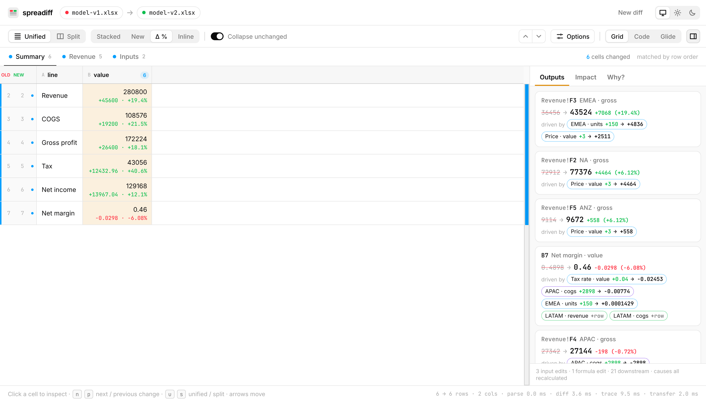
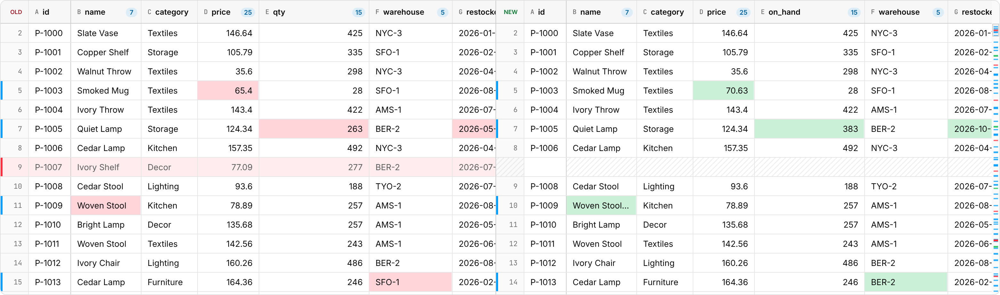
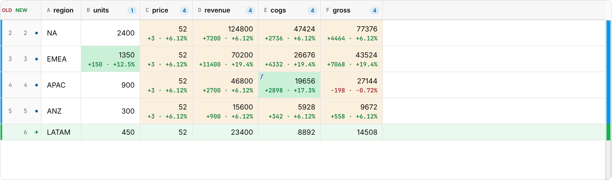

# spreadiff

**An elegant but fully featured spreadsheet diff and UI library.**

spreadiff diffs CSV and Excel files the way a spreadsheet is read: by rows
and columns, not lines of text. For workbooks with formulas, it separates
what someone *edited* from what *moved as a consequence*. It traces every
changed result back to the edits that caused it, with how much each one
contributed.

It comes as two packages:

| Package | For | What you get |
| --- | --- | --- |
| **`spreadiff`** | People reviewing changes | A canvas grid that scrolls a million rows, a React component, static HTML for a pull request or an email, and a Web Worker |
| **[`spreadiff-lite`](docs/spreadiff-lite.md)** | Agents, CI and scripts | No UI. A Markdown or JSON report of every edit, its before and after values, and what it moved downstream, from an API or a CLI |



*Two versions of a small financial model. Price, EMEA units and the tax
rate were edited, APAC's COGS formula was rewritten, and a LATAM row was
added. The amber cells are formula results that moved because of those
edits; the panel lists each changed output and what drove it.*

### What spreadiff-lite prints

```bash
npx spreadiff-lite regions-v1.xlsx regions-v2.xlsx
```

Growth went from 10% to 12%, and the Bloomberg rupee rate refreshed from
83 to 84. An excerpt:

<!-- excerpt-of: lite-regions -->
```markdown
**2 edits** (1 input, 1 outside-data value) moved **4 results downstream** (2 final outputs). Every cause was found by recalculating.

| Cell | What | Before | After | Change | Driven by |
| --- | --- | --- | --- | --- | --- |
| `Model!B5` | India › Profit (USD) · 2024 | 50 | 49.4047619047619 | −0.5952380952381 (−1.19%) | USD/INR −0.5952 |
| `Model!C5` | India › Profit (USD) · 2025 | 55 | 55.3333333333333 | +0.3333333333333 (+0.61%) | Growth +0.9881; USD/INR −0.6667 |
```

Every cell is named the way the sheet names it (`India › Profit (USD) ·
2025`). A value from a data feed such as Bloomberg's `BDP` is taken as
saved and reported as an input, because it can't be recalculated without
the connection. [spreadiff-lite](docs/spreadiff-lite.md) shows the full
report.

## Why spreadiff

- **It understands tables.**
  - Columns match by name, and renamed columns are detected from their contents.
  - Rows match by an id column when there is one, and by sequence alignment when there isn't.
  - An edited row reads as *modified*, not as a deletion plus an insertion.
  - A reordered row reads as *moved*.
  - Headers read like the sheet: rows are labelled `India › Revenue` and
    columns `FY2025`, inferred from the layout, instead of `7` and `C`.
    [Row numbers and letters](docs/grid.md#row-and-column-headers) are an
    option away.
- **It explains formula changes.** Every changed cell is an input edit, a
  formula edit, or a downstream result. For each result, spreadiff finds
  the edits that actually moved it by undoing each one and recalculating
  the workbook with its own formula engine. It also finds results that
  were saved stale.
- **It's verified against a real spreadsheet engine.**
  - Causes and contributions are checked against LibreOffice's
    recalculation on generated models and on real files saved by Excel.
  - The same checks run in a browser, on a statically hosted build with
    the network blocked.
  - The numbers are [below](#how-correct-is-it).
- **It's fast.**
  - The grid draws only the visible cells, so a million-row diff scrolls
    like a ten-row one.
  - Parsing, diffing and tracing run in a Web Worker.
- **It runs anywhere.**
  - `spreadiff/html` has no DOM dependency, so the same diff renders in
    Node, in CI, or on an edge function.
  - Nothing is sent to a server.
  - It works under a strict Content-Security-Policy.
- **It's accessible.**
  - Screen readers get an ARIA grid of the visible cells, and the arrow
    keys announce each cell.
  - Text meets WCAG AA contrast in light and dark, checked by tests,
    axe-core included.

| Side by side | Downstream changes, traced |
| --- | --- |
|  |  |

| New value + Δ and % | Static HTML (`spreadiff/html`) |
| --- | --- |
|  |  |

## Quick start

spreadiff isn't on npm yet. [Getting started → Install](docs/getting-started.md#install)
builds it from this repository.

**A grid in the browser:**

```ts
import { DiffGrid, diffTables, parseCsv } from 'spreadiff';

const diff = diffTables(parseCsv(before), parseCsv(after)); // rows match by an id column if there is one
new DiffGrid({ layout: 'split', cellDisplay: 'delta' }).render({ diff, container }); // give the container a height
```

**Two Excel files, with formulas traced, off the main thread:**

```ts
import { DiffGrid } from 'spreadiff';
import { createDiffWorker } from 'spreadiff/worker';

const differ = createDiffWorker(new Worker(new URL('spreadiff/worker/worker.js', import.meta.url), { type: 'module' }));
const { result, trace } = await differ.diffFiles(oldFile, newFile, {}, { trace: true });
new DiffGrid({ trace: trace && { trace, workbook: result, sheet: 0 } }).render({ diff: result.sheets[0].diff, container });
```

**React:**

```tsx
import { DiffGrid } from 'spreadiff/react';

export const Review = () => <DiffGrid diff={diff} layout="unified" style={{ height: 600 }} />;
```

**HTML or text, on a server or in CI:**

```ts
import { HTML_CSS, renderHTML, renderText } from 'spreadiff/html';

const html = `<style>${HTML_CSS}</style>` + renderHTML(diff, { layout: 'split' });
const text = renderText(diff, { changedColumnsOnly: true }); // for a ```diff block in a PR comment
```

[Recipes](docs/recipes.md) has complete versions of these and more:
- explain why a result changed;
- comment on a pull request;
- diff two workbooks from the command line;
- review comments on rows.

## How correct is it?

A diff tool is only useful if it's right, so the tracing is checked
against LibreOffice, which really recalculates. The cases are five
generated models and real workbooks from the
[Apache POI](https://github.com/apache/poi) test corpus, almost all saved
by Excel. Scripted edits are applied and recalculated, with each edit
also left out in turn: that gives the ground truth for every cause and
contribution.

| Check | Result |
| --- | --- |
| Changed cells classified correctly (input, formula edit, downstream) | 100% of 2,172 |
| Causes of downstream changes: precision / recall | 100% / 100% |
| Contributions equal to LibreOffice's | 3,400 of 3,400 |
| Formulas whose recalculated value matches the saved one | 99.8% of 46,249 |
| Values computed for files saved without them | 12,560 of 12,560 |
| The same checks, in Chromium, hosted, network blocked | 1,955 / 1,955 causes · 3,304 / 3,304 contributions |

When spreadiff's engine can't reproduce a formula, it says so: that
part of the trace falls back to following references, and is marked
that way. [Tracing → How it was tested](docs/tracing.md#how-it-was-tested)
has the method, every number, and the failure cases. `npm run bench:trace`
and `npm run test:hosted` reproduce them.

## Entry points

| Import | Contents | min + gzip |
| --- | --- | --- |
| `spreadiff/html` | Diff engine, CSV parser, HTML and text renderers. No DOM | 16.0 KB |
| `spreadiff/core` | + XLSX reader, formula engine and tracing | 43.4 KB |
| `spreadiff` | + canvas `DiffGrid` | 63.9 KB |
| `spreadiff/react` | React component for `DiffGrid` | + React |
| `spreadiff/worker` | Parse, diff and trace in a Web Worker | |

## Performance

In headless Chromium on a 4-core VM, with 1M rows × 12 columns, the grid
scrolled at a 95th-percentile frame time of 17–22 ms in the published
runs (25–29 ms on a slower day, when Glide Data Grid was slower by the
same factor). A keyed diff took about 1–1.3 s in a worker. Some runs have
a single long frame at that size; the cause isn't confirmed. With tracing
in the worker, the longest stall while loading a 10,000-formula model was
41–102 ms.
[Performance](docs/performance.md) has the method, all the numbers, and
how they could be wrong.

## Browser support

The grid needs Chrome / Edge 111, Firefox 113 or Safari 16.2 (it uses
CSS `color-mix()`). `spreadiff/html` and `spreadiff/core` run in Node 18 and any 2022+
runtime. Testing is in Chromium and Node; Firefox and Safari aren't
tested yet. See [Browser support](docs/browser-support.md).

## Limits

- **Files.** No legacy `.xls`, `.xlsb` or `.ods`. Styles and number
  formats other than dates aren't read, so a change of format alone isn't
  a change.
- **One spreadsheet engine.** Recalculation is spreadiff's own engine,
  checked against LibreOffice, not Excel. Files saved by different apps
  can differ slightly with nothing edited.
- **Untested.** Firefox and Safari aren't tested, and neither is manual
  screen-reader use (automated accessibility checks pass).
- **Memory.** Very large files hold both tables in the page's memory.

The full list, with what's been closed, is in
[Design notes → Known gaps](docs/design.md#known-gaps).

## Documentation

- **Start:** [Getting started](docs/getting-started.md) · [Recipes](docs/recipes.md) · [Troubleshooting](docs/troubleshooting.md)
- **Guides:**
  - [How diffing works](docs/diffing.md)
  - [Tracing](docs/tracing.md)
  - [The DiffGrid](docs/grid.md)
  - [spreadiff/html](docs/html.md)
  - [Workers](docs/workers.md)
  - [Theming](docs/theming.md)
  - [Accessibility](docs/accessibility.md)
- **Reference:**
  - [API](docs/api.md)
  - [Browser support](docs/browser-support.md)
  - [Performance](docs/performance.md)
  - [Design notes](docs/design.md)
  - [Changelog](CHANGELOG.md)

## This repository

| Path | Contents |
| --- | --- |
| `packages/spreadiff` | The library |
| `apps/viewer` | A drag-and-drop viewer built on it, with a Glide Data Grid mode for comparison |
| `test/hosted` | Real `.xlsx` fixtures with LibreOffice's answers, for the in-browser test |
| `bench/` | Scroll benchmark, bundle sizes, browser tests, the render fuzzer, the trace evaluation |
| `scripts/` | Documentation checks, screenshots, the bundling and hosted tests |
| `docs/` | The documentation |

```bash
npm install
npm run dev        # the viewer, at http://localhost:5173
npm test           # unit tests
```

[CONTRIBUTING.md](CONTRIBUTING.md) lists every check and when to run it.
spreadiff is [MIT licensed](LICENSE).
