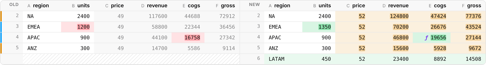

# spreadiff

Spreadsheet diffs for the web: what [`@pierre/diffs`](https://diffs.com) does
for code, for tables. Diff two CSV or XLSX files, then see the result as a
canvas grid that scrolls a million rows, or as static HTML for a pull
request or an email. For spreadsheets with formulas, spreadiff separates
what someone *edited* from what *moved as a consequence*, and traces each
changed result back to its causes.


*Above: two versions of a small financial model. Price, EMEA units and the
tax rate were edited, APAC's COGS formula was rewritten, and a LATAM row
was added. The amber cells are formula
results that changed because of those edits. Each shows its new value, the
absolute change and the percent change. The panel lists the changed outputs
and what drove each one.*

## What it does

- **Table-aware diffing.** Columns match by name, with renames detected
  from their contents. Rows match by an id column when there is one, and
  by sequence alignment when there isn't. An edited row reads as
  *modified*, not as a deletion plus an insertion.
- **Formula tracing.** Every changed cell is an `input` edit, a `formula`
  edit, or a `computed` change: same formula, new result. Computed changes
  link back to their root causes. Formulas are compared by what they point
  at, so `=B5*C5` becoming `=B6*C6` after a row insert isn't a change.
- **A canvas grid.** It's virtualized and themed with CSS variables, in
  unified or split layouts. There are four ways to show a changed cell,
  plus annotations, keyboard navigation and a change minimap.
- **A lightweight HTML renderer.** `spreadiff/lite` is 11.8 KB gzip and
  uses no DOM APIs, so it runs on a server. It renders a code-review style
  side-by-side diff.
- **Worker support.** Parse and diff off the main thread. Results come back
  in a packed transferable encoding.

| Side by side | Downstream changes, traced |
| --- | --- |
|  |  |

| New value + Δ and % | Static HTML (`spreadiff/lite`) |
| --- | --- |
|  |  |

## Quick start

spreadiff isn't on npm yet; see [Install](docs/getting-started.md#install)
to build it from this repository.

```ts
import { DiffGrid, diffTables, parseCsv } from 'spreadiff';

const diff = diffTables(parseCsv(before), parseCsv(after)); // matches rows by an id column if there is one
const grid = new DiffGrid({ layout: 'split', cellDisplay: 'delta' });
grid.render({ diff, container }); // give the container a height
```

With React:

```tsx
import { DiffGrid } from 'spreadiff/react';

export const Review = () => <DiffGrid diff={diff} layout="unified" collapseUnchanged style={{ height: 600 }} />;
```

As HTML, anywhere:

```ts
import { LITE_CSS, renderHTML } from 'spreadiff/lite';

const html = `<style>${LITE_CSS}</style>` + renderHTML(diff, { layout: 'split' });
```

## Entry points

| Import | Contents | min + gzip |
| --- | --- | --- |
| `spreadiff/lite` | Diff engine, CSV parser, HTML and text renderers | 11.8 KB |
| `spreadiff/core` | + XLSX reader, formula engine and tracing | 37.4 KB |
| `spreadiff` | + canvas `DiffGrid` | 52.6 KB |
| `spreadiff/react` | React component for `DiffGrid` | + React |
| `spreadiff/worker` | Parse and diff in a Web Worker | |

## Documentation

- [Getting started](docs/getting-started.md)
- Guides: [How diffing works](docs/diffing.md) · [Tracing](docs/tracing.md) · [The DiffGrid](docs/grid.md) · [spreadiff/lite](docs/lite.md) · [Theming](docs/theming.md) · [Workers](docs/workers.md)
- Reference: [API](docs/api.md) · [Performance](docs/performance.md) · [Design notes](docs/design.md)

## Performance, briefly

At 1M rows × 12 columns in headless Chromium on a 4-core VM, the grid's
95th-percentile frame time was 17.1–21.5 ms while scrolling every row, and
a keyed diff took 1.1–1.3 s in a worker. One run in three had a single
~220 ms frame at that size; the cause isn't confirmed yet.
[Performance](docs/performance.md) has the method, all the numbers, and
how they could be wrong.

## Limits

- Values come from the cached results in the file. Nothing is
  recalculated, so tracing finds causes but can't split a change into
  contributions.
- The XLSX reader reads values and formulas: no styles, merged cells or
  legacy `.xls`.
- Canvas cells aren't exposed to screen readers yet.

More in [Design notes → Known gaps](docs/design.md#known-gaps).

## This repository

| Path | Contents |
| --- | --- |
| `packages/spreadiff` | The library |
| `apps/viewer` | A drag-and-drop viewer built on it, with a Glide Data Grid mode for comparison |
| `bench/` | Scroll benchmark, bundle sizes, browser tests and the render fuzzer |
| `scripts/` | Documentation checks, screenshot generation, the bundling test |
| `docs/` | The documentation |

```bash
npm install
npm run dev        # the viewer, at http://localhost:5173
npm test           # unit tests
```

[CONTRIBUTING.md](CONTRIBUTING.md) lists every check and when to run it.
