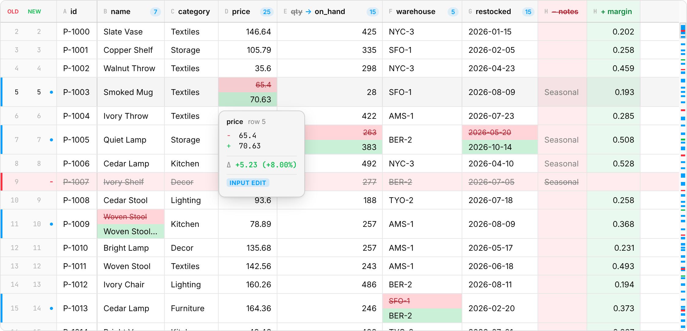
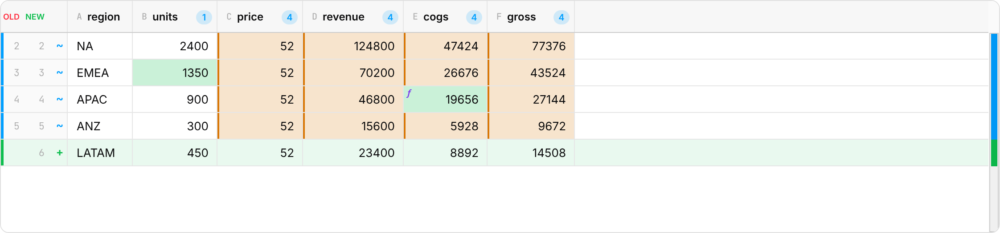
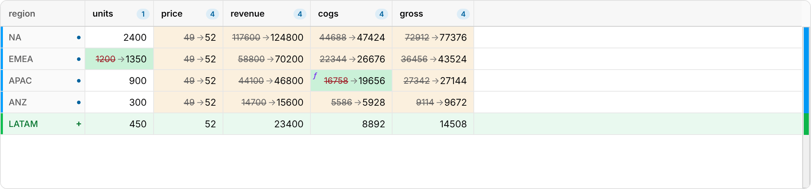
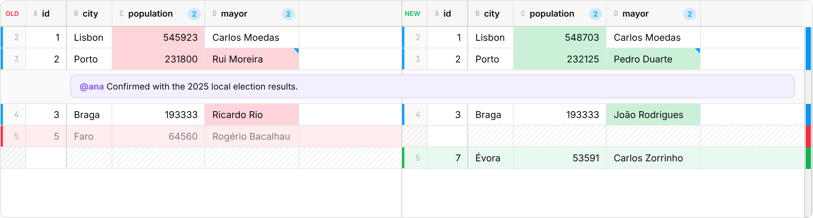

# The DiffGrid

`DiffGrid` renders a [`TableDiff`](api.md#tablediff) as an interactive,
scrollable grid. It draws on a canvas and only paints the visible cells, so
a million-row diff scrolls like a ten-row one. Styling goes through CSS
variables ([Theming](theming.md)), and the rest of the page is isolated by
Shadow DOM.



<!-- demo: grid -->

## Mounting

```ts
import { DiffGrid, diffTables, parseCsv } from 'spreadiff';

const grid = new DiffGrid({ layout: 'unified', cellDisplay: 'stacked' });
grid.render({ diff: diffTables(parseCsv(before), parseCsv(after)), container });
```

- **Give the container a size.** The grid fills it exactly and scrolls
  inside it, so a `div` with `height: 0` shows nothing. Any CSS that sizes
  the container works: a fixed height, `flex: 1`, `position: absolute; inset: 0`.
- **Update in place.** `grid.setDiff(newDiff)` and
  `grid.setOptions({ layout: 'split' })` are cheap: options that don't
  affect layout (callbacks, `tooltips`) only trigger a repaint.
- **Clean up.** `grid.cleanUp()` removes the grid and its observers.

### React

```tsx
import { useMemo, useRef } from 'react';
import { DiffGrid, type DiffGridHandle } from 'spreadiff/react';
import { diffTables, parseCsv } from 'spreadiff';

export function Review({ a, b }: { a: string; b: string }) {
  const diff = useMemo(() => diffTables(parseCsv(a), parseCsv(b)), [a, b]);
  const grid = useRef<DiffGridHandle>(null);
  return (
    <div style={{ display: 'flex', flexDirection: 'column', height: 600 }}>
      <button onClick={() => grid.current?.nextChange()}>Next change</button>
      <DiffGrid ref={grid} diff={diff} layout="split" style={{ flex: 1 }} />
    </div>
  );
}
```

Props are the [options](#options) plus `diff`, `className` and `style`. The
`ref` exposes the [methods](#methods) (`DiffGridHandle`), and
`ref.current.instance` gives the underlying `DiffGrid`. Memoize `diff` (and
`annotations`): a new object resets the scroll position.

## Layouts

| `layout: 'unified'` | `layout: 'split'` |
| --- | --- |
| One grid. A changed cell shows old and new together. Two row-number gutters (old, new) and a marker per row: `+` added, `−` removed, a dot for modified, `↕` for moved | Old on the left, new on the right, rows aligned and scrolled together. Rows and columns that exist on one side only are hatched on the other |
|  |  |

For a code-review-style split view rendered as HTML instead of canvas, see
[spreadiff/html](html.md).

## Displaying a change

`cellDisplay` sets how a changed cell reads:

| `stacked` (default) | `new` | `delta` | `inline` |
| --- | --- | --- | --- |
| Old value struck through above the new one | Only the new value, on a tinted background | New value, with the absolute and % change below (text cells show `was …`) | `old → new` on one line |
|  |  |  |  |

`stacked` and `delta` make modified rows taller; `new` and `inline` keep
every row the same height, so more rows fit on screen. Columns size
themselves for the active display. When a delta still doesn't fit, it
shortens to the % change, then to the absolute change.

In every display:
- downstream (computed) changes are **amber**, and formula edits carry an
  `ƒ` in the corner ([Tracing](tracing.md));
- the hover popover always shows the full old → new, a character-level
  diff for text, and the Δ for numbers;
- a row that moved (rows matched by key) shows `↕` in the gutter, and its
  popover says which row it moved from ([Moved rows](diffing.md#moved-rows));
- an XLSX merge across columns (a title over a block, say) draws as one
  cell where nothing in it changed. A changed cell inside a merge keeps its
  own box, so both values stay visible. Merges down rows are drawn cell by
  cell: an inserted row can split them.

## Options

| Option | Default | What it does |
| --- | --- | --- |
| `layout` | `'unified'` | `'unified'` or `'split'` |
| `cellDisplay` | `'stacked'` | `'stacked'`, `'new'`, `'delta'` or `'inline'` |
| `collapseUnchanged` | `true` | Fold runs of unchanged rows into separators. Click one to expand it |
| `context` | `2` | Unchanged rows kept around each change when folding |
| `hideUnchangedColumns` | `false` | Hide columns with no changed cells. Key, added, removed and renamed columns stay; without keys, so does the first mostly-text column, which names the rows |
| `frozenColumns` | `'keys'` | Pin columns while scrolling sideways: `'keys'` moves the key columns to the front and pins them; a number pins that many leading columns |
| `columnWidths` | — | Fixed widths in px, by column name. Others size to their content (also resizable by dragging a header edge) |
| `rowNumberOffset` | from `origin` | Added to row indexes for display. By default numbers match the sheet |
| `theme` | `'system'` | `'system'` follows the page; `'light'` / `'dark'` force one |
| `minimap` | `true` | Change overview on the right edge. Click to jump |
| `tooltips` | `true` | Popover on changed cells |
| `highlightComputed` | `true` | Amber for downstream changes, `ƒ` for formula edits |
| `trace` | — | `{ trace, workbook, sheet }` from [`traceWorkbook`](tracing.md): causes in tooltips, focus on select |
| `traceFocus` | `true` | With a trace: outline the selected cell's causes and impacts, dim the rest |
| `annotations` | — | Notes below rows; see [Annotations](#annotations) |
| `renderAnnotation` | — | Renders an annotation's content |
| `onCellClick` | — | `(cell, event)`, on pointer down on a cell |
| `onCellHover` | — | `(cell \| null)`, when the pointer enters a cell or leaves the cells |
| `onSelectionChange` | — | `(cell \| null)`, whenever the selection changes, by any means |
| `accessibility` | `true` | Mirror the visible cells as hidden ARIA rows and cells for screen readers; see [Accessibility](#accessibility) |
| `ariaLabel` | a change summary | The grid's accessible name, e.g. "Spreadsheet diff: 3 rows modified, 1 row added, 7 cells changed" |

Callbacks receive a [`CellInfo`](api.md#cellinfo): the aligned row and
column, row status, old and new values and formulas, whether the cell
changed or its row moved, its change kind, and its trace.

## Methods

| Method | |
| --- | --- |
| `render({ diff, container })` | Mount and show a diff |
| `setDiff(diff)` | Show another diff (resets scroll, selection, expanded regions and resized columns) |
| `setOptions(partial)` | Change options; cheap when nothing layout-related changed |
| `getOptions()` | Current options |
| `nextChange()` / `prevChange()` | Select the first changed cell of the next / previous block of changes. `false` at the end |
| `scrollToRow(row, align?)` | Scroll an aligned row into view (`'start'`, `'center'`, `'nearest'`), expanding its region if folded |
| `select(row, col)` / `select(null)` | Select a cell by aligned row and column index. `false` if out of range |
| `expandAll()` / `collapseAll()` | Unfold / refold every unchanged region |
| `cellInfo(row, col)` | Everything about a cell. Throws `RangeError` if it doesn't exist |
| `refreshTheme()` | Re-read CSS variables after changing them from script |
| `cleanUp()` | Unmount and release everything |

## Keyboard and mouse

| Input | Action |
| --- | --- |
| `n` or `j` / `p` or `k` | Next / previous change |
| Arrow keys | Move the selection (starts at the top visible row) |
| ⌘C / Ctrl+C | Copy the selected cell's value (full precision) |
| Esc | Clear the selection |
| Tab | Leave the grid (never trapped) |
| Click a cell | Select it |
| Hover a changed cell, or a cell of a moved row | Popover after a short delay |
| Click a "N unchanged rows" separator | Expand it |
| Click the minimap | Jump there |
| Drag a header's right edge | Resize the column |

The grid takes keyboard input when it has focus: click it, or Tab to it.

## Annotations

Attach notes to rows: review comments, validation errors, explanations.
Each annotation renders full-width below its row and scrolls with it; set
`column` to also mark that cell with a corner triangle.

```ts
import { DiffGrid, type CellAnnotation } from 'spreadiff';

type Note = { author: string; text: string };
const notes: CellAnnotation<Note>[] = [{ row: 1, column: 'mayor', data: { author: 'ana', text: 'Confirmed with the election results.' } }];

const grid = new DiffGrid<Note>({
  annotations: notes,
  renderAnnotation: (a) => {
    const el = document.createElement('div');
    el.className = 'note'; // styled by your page CSS
    el.textContent = `@${a.data.author}: ${a.data.text}`;
    return el;
  },
});
```



Annotation elements live in your page's DOM (projected into the grid
through a `<slot>`), so your stylesheets apply to them. Their height is
measured, and re-measured as they resize. In React, `renderAnnotation`
returns JSX and is portaled into place:

```tsx
import { useMemo } from 'react';
import { DiffGrid } from 'spreadiff/react';

export function Annotated() {
  const notes = useMemo(() => [{ row: 3, data: 'Price checked with supplier' }], []);
  return <DiffGrid diff={diff} annotations={notes} renderAnnotation={(a) => <div className="note">{a.data}</div>} style={{ height: 500 }} />;
}
```

**Identity.** Across updates, annotations are matched by `id` when you
give one, and otherwise by row and column. A fresh array of equal
annotations keeps its elements, and an annotation is re-rendered only when
its `data` changes (by `===`). So you don't have to memoize the array.
Give an `id` when an annotation can move to another row and should keep
its element (and any state in it, such as a half-typed reply).

## Accessibility

Cells are painted on a canvas, which screen readers can't see, so the grid
keeps a visually hidden copy of the visible window as an ARIA grid:
column headers, a row header per row ("Row 12, modified, moved from row
4"), and a cell per visible column that reads the change in words
("70.63, was 65.4, up 5.23 (8.0%), edited"). The selected cell is the
grid's `aria-activedescendant`, so moving with the arrow keys announces
each cell. The grid's accessible name summarises the diff, and the hover
popover is attached with `aria-describedby` while it's open.

Text and status colours meet WCAG AA contrast in light and dark. The
tests check the canvas colours themselves, and run axe-core over the
grid, `spreadiff/html` and the viewer. [Accessibility](accessibility.md)
has what's covered, how it's tested, and what isn't (no manual
screen-reader testing yet).

## Performance notes

- Only visible cells are drawn. Scrolling at 60fps is the same at 100 rows
  and 1M rows; see [Performance](performance.md) for measurements.
- Layout work (folding regions, row heights) is linear in the number of
  aligned rows and runs only when the diff or a layout option changes.
- Memory is dominated by the two tables themselves. The diff adds 10 bytes
  per aligned row (two `Int32Array`s and two `Uint8Array`s) plus a mask
  per modified row; the grid's layout adds about 17 bytes per displayed row.
- The accessibility mirror holds DOM for the visible window only (tens of
  rows), rebuilt when scrolling settles rather than every frame. Scrolling
  benchmarks with it on and off didn't differ (p95 21.5–23.4 ms vs.
  22.3–23.5 ms at 100k rows). `accessibility: false` skips it.
