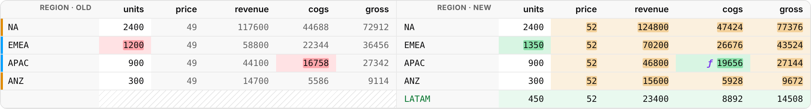
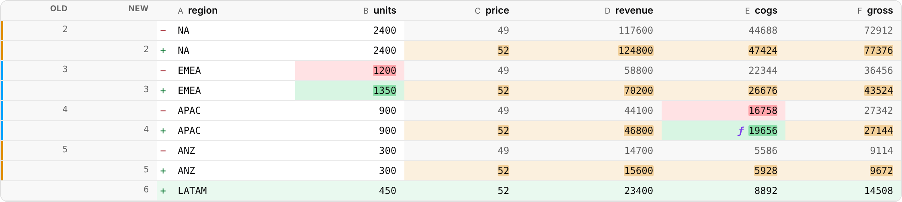

# spreadiff/html

`spreadiff/html` renders a diff as an **HTML string** or as **plain text**.
It uses no canvas, no DOM APIs and no workers, so the same call works in a
browser, a Node server, a CI job or a static-site build. At 19.9 KB
(min+gzip) for the diff engine, the CSV parser and both renderers, it's the
lightest way to use spreadiff.

It shows **changes plus a little context**, the way a code review does. Use
it to review edits, email a summary, or post a PR comment. To scroll through
a large sheet, use the [DiffGrid](grid.md).

| `layout: 'split'` | `layout: 'unified'` |
| --- | --- |
|  |  |

<!-- demo: html -->

## HTML

```ts
import { diffTables, HTML_CSS, parseCsv, renderHTML } from 'spreadiff/html';

const html = renderHTML(diffTables(parseCsv(before), parseCsv(after)), { layout: 'split' });
container.innerHTML = `<style>${HTML_CSS}</style>${html}`;
```

- **`split`** puts old and new side by side, one row per line, with line
  numbers on both sides. It's like a code review: unchanged runs fold into
  `⋯ 12 unchanged rows`, missing rows are hatched, and changed text has its
  differing characters highlighted.
- **`unified`** renders each modified row as a `−` line and a `+` line, like
  `git diff`. With `display: 'new' | 'delta' | 'inline'` it's one line per
  row instead.

Cell values are HTML-escaped: rendering an untrusted file is safe.

### Options

| Option | Default | |
| --- | --- | --- |
| `layout` | `'split'` | `'split'` or `'unified'` |
| `display` | `'stacked'` | `'stacked'`, `'new'`, `'delta'` or `'inline'`, as in the [grid](grid.md#displaying-a-change) |
| `context` | `2` | Unchanged rows shown around each change |
| `changedColumnsOnly` | `false` | Only columns with changes, plus key columns (or, when rows were matched by order, the first mostly-text column, which names the rows) |
| `maxRows` | `2000` | Stop after this many rows; a note says how many more changed rows exist |
| `kindOf` | local | `(row, col) => ChangeKind` override, e.g. from a [trace](tracing.md) |
| `rowNumberOffset` | from `origin` | Row number of row index 0 |
| `rowHeaders` | `'labels'` | What the row headers show: `'labels'` (inferred row labels, as in the [grid](grid.md#row-and-column-headers)), `'numbers'` or `'both'` |
| `columnHeaders` | `'labels'` | `'labels'` (headings), `'letters'` or `'both'` |
| `foldLabels` | `true` | With labels, leave out unchanged label columns and heading rows |

Downstream (computed) changes are amber, formula edits get an `ƒ`, and
deltas are green or red by direction, as in the grid.

### Styling

`HTML_CSS` styles everything under `.sdl-wrap`. It reads the same `--sd-*`
variables as the grid (see [Theming](theming.md#tokens)): `--sd-bg`,
`--sd-fg`, `--sd-added`, `--sd-removed`, `--sd-modified`, `--sd-computed`,
`--sd-formula`, `--sd-font-family`, `--sd-mono-font-family`. Light and dark
follow `color-scheme`. Include it once per page; the rest of the page is
untouched.

## Plain text

`renderText` produces an aligned, monospace diff for terminals, logs and
Markdown code blocks:

<!-- example: render-text -->
```ts
import { diffTables, parseCsv, renderText } from 'spreadiff/html';

const before = parseCsv('id,name,price\n1,Lamp,10\n2,Chair,20\n3,Desk,30\n4,Mug,4\n5,Rug,50\n6,Vase,6\n7,Tray,7');
const after = parseCsv('id,name,price\n1,Lamp,10\n2,Armchair,25\n3,Desk,30\n4,Mug,4\n5,Rug,50\n6,Vase,6\n8,Clock,12');
console.log(renderText(diffTables(before, after), { context: 0 }));
```

<!-- output: render-text -->
```text
   id  name      price
⋯  1 unchanged row
-  2   Chair     20
+  2   Armchair  25
⋯  4 unchanged rows
-  7   Tray      7
+  8   Clock     12
```

Columns are padded to their widest value (capped by `maxWidth`, default 24
characters) and line breaks inside cells become spaces.

When rows are matched by key, a row that [moved](diffing.md#moved-rows) is
marked: `~` and "(moved from row N)" in text, `↕` with the same title in
HTML. A moved row that also changed shows its `-`/`+` pair, with the note
on the `+` line.

## Recipes

### A pull-request comment from CI

```ts
import { readFileSync } from 'node:fs';
import { diffTables, hasChanges, parseCsv, renderText } from 'spreadiff/html';

const d = diffTables(parseCsv(readFileSync('prices.base.csv', 'utf8')), parseCsv(readFileSync('prices.csv', 'utf8')));
const body = !hasChanges(d)
  ? 'No changes to prices.csv'
  : `**prices.csv**: ${d.stats.rowsModified} edited, ${d.stats.rowsAdded} added, ${d.stats.rowsRemoved} removed\n\n` +
    '```diff\n' + renderText(d, { changedColumnsOnly: true }) + '```';
console.log(body); // post with your CI's comment action
```

Lines start with ASCII `+` and `-`, so fencing the text as `diff` makes GitHub color them.

### Server-rendered HTML

```ts
import { diffTables, HTML_CSS, parseCsv, renderHTML } from 'spreadiff/html';

export function diffPage(a: string, b: string): string {
  const html = renderHTML(diffTables(parseCsv(a), parseCsv(b)), { layout: 'split', display: 'delta' });
  return `<!doctype html><meta charset="utf-8"><style>${HTML_CSS}</style>${html}`;
}
```

### With a formula trace

`renderHTML` classifies changes itself (input, formula, computed). With a
full [trace](tracing.md), pass its kinds through `kindOf`, for example to
color cells of added rows that feed totals:

```ts
import { traceWorkbook } from 'spreadiff';
import { renderHTML } from 'spreadiff/html';

const trace = traceWorkbook(workbookDiff);
const html = renderHTML(workbookDiff.sheets[0].diff, {
  kindOf: (row, col) => trace.get({ sheet: 0, row, col })?.kind,
});
```

(`traceWorkbook` is in `spreadiff/core`, not in `spreadiff/html`.)

## What's in the box

`spreadiff/html` exports `renderHTML`, `renderText`, `HTML_CSS`, and the
pieces needed to produce a diff: `diffTables`, `parseCsv`, `cellsEqual`,
`changeKind`, `formatCell`, `numericDelta` and `diffText`. It doesn't
include the XLSX parser (`spreadiff/xlsx`) or tracing (`spreadiff/core`):
import those separately if you need them, and your bundler keeps only what
you use.
