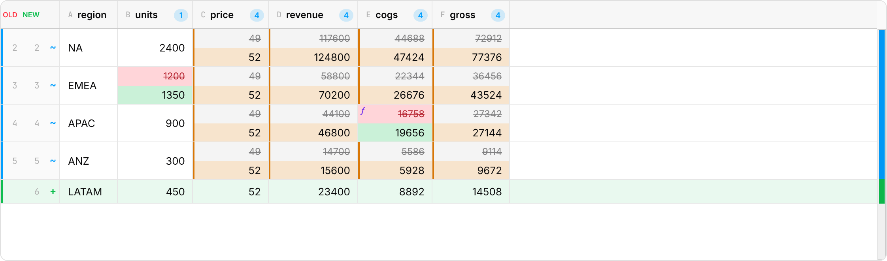
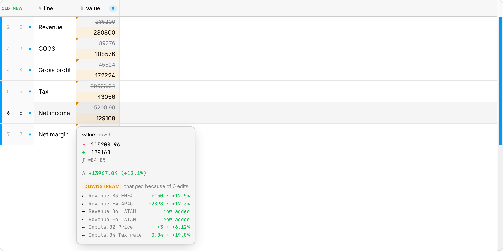
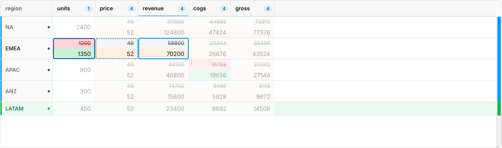
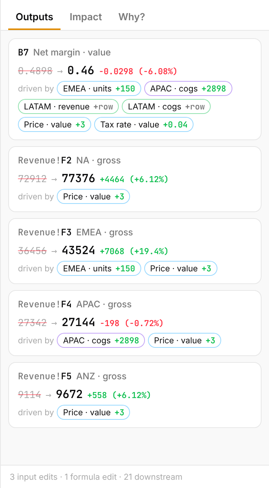
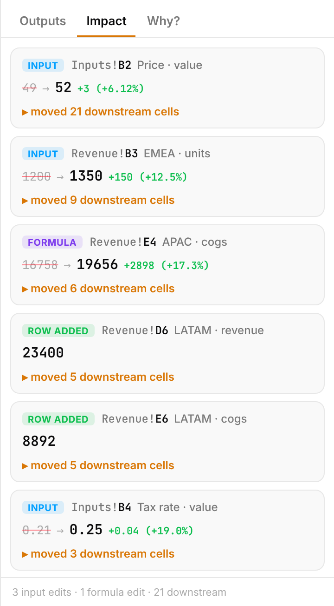
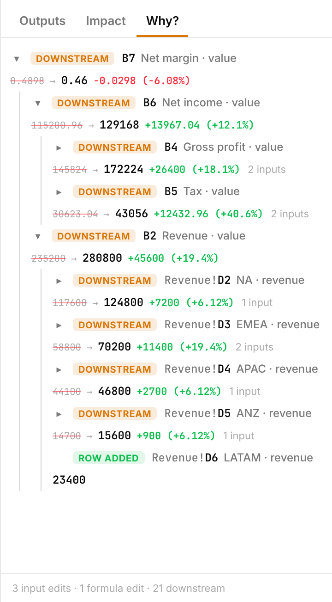

# Tracing downstream changes

In a spreadsheet model, most changed cells weren't edited. They're formula
results that moved *because* something upstream was edited. Change one
price, and every revenue, margin and total that depends on it changes too.
A plain diff shows all of them in the same colour, and the one edit that
caused them disappears in the noise.

spreadiff separates the two, traces each result back to the edits that
caused it, and says how much each edit contributed.



<!-- demo: trace -->

## Four kinds of change

Every changed cell gets a [`ChangeKind`](api.md#changekind):

| Kind | What happened | Grid colour |
| --- | --- | --- |
| `input` | A typed-in value was edited | green / red |
| `formula` | A formula was edited (compared by meaning; see [Formulas](diffing.md#formulas)) | green / red, with `ƒ` |
| `computed` | **Same formula, new result**: a downstream change | amber |
| `added` / `removed` | A cell of an added or removed row/column that feeds a formula | row tint |

An `input` can also hold a formula, when that formula reads **outside
data**: Bloomberg's `BDP`, Capital IQ, FactSet, `RTD`, `WEBSERVICE`, a
link to another workbook. Such a value can't be recalculated without the
connection, and it can change when nothing in the file did. So the trace
takes its saved value as given, and treats a change to it as an edit:
`trace.get(ref).external` says where it came from (`{ provider:
'Bloomberg', function: 'BDP' }`). The results it feeds are traced to it.
[spreadiff-lite → Outside data](spreadiff-lite.md#outside-data) lists the
functions recognised, and `TraceOptions.liveFunctions` adds your own.

Telling `input` from `computed` needs only the two files, not a full
trace. So the grid colours downstream changes amber by default
(`highlightComputed`), even with no trace attached.

## Causes and contributions

<!-- example: trace -->
```ts
import { diffWorkbooks, traceWorkbook, type Table, type Workbook } from 'spreadiff';

// price × qty = total, and a grand total: =SUM(D2:D3)
const book = (applePrice: number): Workbook => {
  const lines: Table = {
    name: 'Lines',
    columns: ['item', 'price', 'qty', 'total'],
    rows: [['apple', applePrice, 10, applePrice * 10], ['pear', 3, 5, 15]],
    formulas: [[null, null, null, '=B2*C2'], [null, null, null, '=B3*C3']],
  };
  const summary: Table = {
    name: 'Summary',
    columns: ['line', 'value'],
    rows: [['Total', applePrice * 10 + 15]],
    formulas: [[null, '=SUM(Lines!D2:D3)']],
  };
  return { name: 'model.xlsx', sheets: [lines, summary] };
};

const diff = diffWorkbooks(book(2), book(2.5));
const trace = traceWorkbook(diff);

const price = trace.get({ sheet: 0, row: 0, col: 1 })!; // Lines!B2
const total = trace.get({ sheet: 1, row: 0, col: 1 })!; // Summary!B2
console.log(price.kind, price.impactCount);
console.log(total.kind, JSON.stringify(total.causes), total.method, JSON.stringify(total.contributions));
```

<!-- output: trace -->
```text
input 2
computed [{"sheet":0,"row":0,"col":1}] recalculated [5]
```

The price edit moved two cells (the apple's total and the grand total).
The grand total traces back to exactly one edit, the price, which
accounts for +5 of its change.

For a cause *tree*, one level at a time, `trace.parents(ref)` returns the
changed cells a formula reads directly.

## How causes are found

Think of a model as dominoes. To know which edit knocked a result over,
stand that one edit back up and see whether the result still falls. If it
doesn't, that edit caused it. The size of the difference is that edit's
contribution. This is a *but-for* cause: but for this edit, the result
would be different.

spreadiff does exactly that, with its own formula engine:

1. **Find the cone.** Collect every formula that could be affected by an
   edit: the formulas that reference an edited, added or removed cell, and
   the formulas that reference those, and so on.
2. **Calibrate.** Evaluate each formula in the cone with the *old* file's
   values, and compare with the result the old file saved. Only formulas
   that reproduce it are trusted. This is what keeps an engine gap (an
   unsupported function, a different rounding rule) from producing a
   wrong answer. Copies of the same formula (`=B2*C2`, `=B3*C3`, …) are
   checked on a sample of 8 before the rest are trusted.
3. **Evaluate in the new file.** This records what each formula *actually*
   read: the branch an `IF` took, the row a `VLOOKUP` returned. That's the
   dependency graph from here on, instead of every reference the formula
   mentions.
4. **Undo each edit, one at a time.** An edited value goes back to its old
   value. An edited formula goes back to its old formula, evaluated on
   today's inputs, so its contribution doesn't absorb what the other edits
   did. (When rows or columns were inserted or deleted, the old formula's
   references no longer line up, and it goes back to its old result
   instead.) Then recalculate, in dependency order, only the cells whose
   inputs moved. Every downstream cell that comes out different has this
   edit as a cause; the difference is its contribution.

The undone state is exactly what LibreOffice computes for the file with
that one edit left out. Checked that way, all 3,400 contributions in the
test corpus match LibreOffice's (see [How it was tested](#how-it-was-tested)).

Contributions needn't add up to the total change. Edits interact: a rate
times a balance, an `IF` that needs two inputs to cross a threshold. A
result can also have two edits that would each have been enough on their
own. When no single edit makes a difference, the causes fall back to the
next method.

### When it can't recalculate

A formula the engine can't evaluate or can't reproduce is **unmodelled**.
Across a formula like that, causes come from **references**: an edit
causes a change if a chain of *changed* cells connects them. That method
never misses a cause, but it can list some that didn't matter. An edit to
the silver commission rate is "a cause" of a salesperson who just moved
from silver to gold, because the formula references both rates.

Each computed cell says which method found its causes:
`trace.get(ref).method` is `'recalculated'` or `'references'`. The tooltip
says it too. Pass `{ recalculate: false }` to use references only. It's
faster, and it's how spreadiff worked before it had an engine.

## Stale and missing values

A file stores each formula's last result next to the formula. Two common
ways those results are wrong:

**Stale:** an input was edited, but the file was saved without
recalculating. Excel in manual calculation mode does this, and so does a
script that writes values with openpyxl. A diff of saved values then
shows the input change and *nothing downstream*. That's the worst
possible failure: it looks like a harmless edit.

The calibration step catches it. When a formula reproduces the old file
but gives a different result from the new file's saved value, that saved
value is stale. The cell is traced with `stale: { cached, recalculated }`,
and it counts as a downstream change even though its saved value didn't
move. `applyRecalculation(diff, trace)` returns the diff with recalculated
values in place, for display. The viewer shows that by default, with a
banner and a button to see the saved values.

A stale claim needs the engine to have reproduced *that exact formula* in
the old file first. A new or edited formula never triggers one; if the
engine and the file disagree there, the file wins.

**Missing:** tools that don't calculate (openpyxl, many exporters) write
formulas with no saved result at all. Diffed as they are, every formula
reads as blank, and every one of them "changes". `parseXlsx` computes
these values when the file is read, in dependency order. It changes no
value the file does have. `Workbook.computedValues` counts what was
computed and what couldn't be (an unsupported function, and anything that
depends on it, stays empty). Turn it off with `{ computeMissing: false }`.

## What the engine understands

About 150 functions:
- arithmetic, comparison and text operators, with Excel's coercions;
- aggregates and conditional aggregates (`SUMIFS`, `COUNTIFS`, `MAXIFS`, with wildcards and operators);
- lookups (`VLOOKUP`, `HLOOKUP`, `INDEX`/`MATCH`, `XLOOKUP`, `LOOKUP`);
- `OFFSET` and `INDIRECT`, which reference-only tracing can't follow;
- logic (`IF`, `IFS`, `IFERROR`, `SWITCH`, `CHOOSE`), text, dates (with Excel's 1900 leap-year bug), rounding the way Excel rounds what it displays;
- loans and investments (`PMT`, `IPMT`, `NPV`, `IRR`, `RATE`, …), matrices;
- defined names, structured references (`Sales[[#This Row],[Qty]]`), 3-D references (`Jan:Mar!B2`), and array formulas.

Deliberately unsupported: `NOW`, `TODAY`, `RAND`, `CELL` and `INFO`. Their
saved values can't be checked, so those cells are unmodelled and keep
their saved values.

## How it was tested

Against [LibreOffice](https://www.libreoffice.org/), which really
recalculates, on two sets of files:
- **Five models** (a three-statement financial model, a SUMIFS budget, an
  inventory with lookups, a 360-month loan, tiered commissions), built
  with openpyxl and calculated and saved by LibreOffice.
- **29 real workbooks saved by Microsoft Excel**, from the
  [Apache POI](https://github.com/apache/poi) test corpus.

For each, scripted edits (inputs that something depends on, one formula
edit, an inserted row) were applied and recalculated by LibreOffice. The
ground truth for causes is **but-for**: edit *i* caused a change in cell C
if C differs between "all edits" and "all edits except *i*". Where no
single edit is but-for, which happens when edits are each sufficient on
their own, the truth is the edits that move C when applied alone.

| | Before (references only) | Now |
| --- | --- | --- |
| Change kind correct (models, 1,761 cells) | 100% | 100% |
| Causes: precision, models | 88.1% | **100%** |
| Causes: recall, models | 100% | **100%** |
| Downstream cells with exactly the right causes, models | 78.6% | **99.4%** |
| Same three, real Excel files (322 downstream cells) | 99.8% / 80.1% / 84.3% | **100% / 100% / 100%** |
| Stale file: downstream changes found (4 models) | 0 | **all** (63, 84, 1,441, 146) |
| Missing values computed equal to LibreOffice's | — | **12,560 of 12,560** |
| Every formula recalculated from its cached inputs reproduces its cached result | — | **99.8%** (46,162 of 46,249) |
| Contributions equal to LibreOffice's (new value − value without that edit) | — | **3,400 of 3,400** (2,980 models, 420 real files) |

The other 0.6% are 11 cells in the budget model whose causes include an
inserted row. The oracle has no single edit to undo for an insert, so
they aren't scored, and they count as misses. None of the scored cells
had a wrong or a missing cause.

The engine check's 87 misses:
- 50 formulas the engine doesn't handle: `CELL("width", …)` (18), and 32
  written with a decimal comma (`=L6-(-4,3)`), which only a European
  locale reads;
- 37 in files LibreOffice re-saved, where the cached result is
  LibreOffice's and differs from Excel's (it reads `TRUE` as 1 in `TEXT`,
  and treats some date codes differently); the same formulas match in
  Excel's own copies.

In these files all of them failed calibration and fell back to
references. That is not a guarantee: calibration checks a sample of each
formula shape (up to 8 cells), so a shape that is right on its sample and
wrong elsewhere would get through.

Two real bugs surfaced in the corpus and are fixed: the header-row and
row-pairing problems listed below. Run it yourself with
`npm run bench:trace` (needs LibreOffice and Python's openpyxl).

### In a browser, hosted

LibreOffice only produced the answers. spreadiff itself runs entirely in
the page: the engine is plain TypeScript, with no server, no WebAssembly
and no `eval`. `npm run test:hosted` checks the hosted setup itself:
- **The library, as a site would use it.** It packs the npm package and
  builds a fresh Vite app with it. The build is served as plain static
  files, and Chromium blocks every request outside the page's origin.
  19 of the cases above are committed as fixtures (`test/hosted/fixtures`),
  with LibreOffice's answers. Each is parsed, diffed and traced in the
  library's worker, then compared cell by cell.
- **The viewer's production build.** Files are uploaded through its file
  inputs, and the test checks the trace panel, banners and contributions.

| In Chromium | Result |
| --- | --- |
| Changed cells found, with the right kind | 2,016 of 2,016 |
| Downstream cells with exactly LibreOffice's causes | **1,955 of 1,955** scored |
| Contributions equal to LibreOffice's | **3,304 of 3,304** |
| Stale files: values after recalculation equal LibreOffice's | 1,843 of 1,843 |
| Files without values: computed values equal LibreOffice's | 12,665 of 12,665 |
| Requests outside the page | 0 |

How long tracing blocks the page is in [Workers → Formula
traces](workers.md#formula-traces). In short, it runs in the worker; the
page pays 35–75 ms for typical models, against about 230 ms when it
traces on the main thread.

## Failure cases

| Situation | What happens | What you see |
| --- | --- | --- |
| New file saved without recalculating | Recalculated, marked stale | Banner; amber cells with the recalculated value; tooltip shows both |
| Formulas without saved values | Computed when parsed | Note with the count; diff of real values |
| A function the engine lacks, or a result it can't reproduce | Causes across that cell come from references | `method: 'references'`; tooltip says some causes may not have mattered |
| `NOW()`, `RAND()`, `CELL()` | Can't be checked; the cell is its own cause | `unexplained: 'volatile'` |
| Old and new files from different spreadsheet apps | Results that differ only by engine show as changes with no cause | `unexplained: 'unknown'`. Excel vs. LibreOffice: 104 such cells in 8 of 29 files, all `TEXT` formats, date rounding, locale and `CELL` |
| Two edits that are each enough on their own | No single undo changes the result, so recalculation finds no cause | `method: 'references'` with both edits. In the 30,000-row grid, 1 of 3,632 cells: `=IF(F>$J$1,"high","low")` went low → high because both F rose and the threshold fell |
| Circular references (iterative calculation) | Not evaluated | References for those cells |
| Links to other workbooks | Not followed | `unexplained: 'dynamic'` |
| Sheet-scoped names (`Rate` defined only on one sheet, `Inputs!Rate` from another) | Resolved: each formula sees its own sheet's names over the workbook's | Traced like any other reference |
| Huge changes (> 300,000 formulas affected, or 2,000,000 evaluations) | Recalculation stops | `trace.truncated`; references for the rest |
| First row holds inputs, not column names | Detected: a first row that formulas read, or that holds numbers other than year labels, is data (its labels still name the columns) | Edits to it are traced like any other cell |

## Showing it

Attach the trace to a grid. To show stale cells with their recalculated
values, give it the recalculated diff:

```ts
import { applyRecalculation, DiffGrid, traceWorkbook } from 'spreadiff';

const trace = traceWorkbook(workbookDiff);
const shown = applyRecalculation(workbookDiff, trace); // same as workbookDiff if nothing was stale
const grid = new DiffGrid({
  trace: { trace, workbook: shown, sheet: 0 }, // `sheet`: which sheet this grid shows
  cellDisplay: 'delta', // new value with Δ and % underneath
});
grid.render({ diff: shown.sheets[0].diff, container });
```

Hovering a downstream cell lists its causes, each with its own change and
its contribution to this cell. Selecting a cell outlines its causes and
dims everything else:

| Tooltip | Focus on select |
| --- | --- |
|  |  |

In the focus view:
- **solid** outlines are root causes;
- **dotted** outlines are computed cells the formula reads directly;
- **dashed amber** outlines are the cells an edit flowed into.

Causes on other sheets appear in the tooltip and in
`CellInfo.trace`; the outlines only cover the visible sheet.

### Panels in the viewer app

The viewer in [`apps/viewer`](../apps/viewer/src/TracePanel.tsx) builds
three panels on top of the trace API. They're example code to copy or adapt,
not library components:

| Outputs | Impact | Why? |
| --- | --- | --- |
| End results that changed (cells nothing else reads), each with the edits that drove it, biggest contribution first | Each edit, ranked by how much it moved | The cause tree of the selected cell |
|  |  |  |

## Cost

Measured in Node on a 4-core cloud VM, with LibreOffice-saved files:

| Workbook | Formulas | Downstream changes | Trace, references only | Trace, recalculated |
| --- | --- | --- | --- | --- |
| Inventory with lookups | 10,206 | 83 | 0.08 s | 0.24–0.36 s |
| Running total, every cell changes | 40,001 | 39,998 | 0.26 s | 1.1 s |
| Lookup grid | 90,002 | 3,632 | 0.31 s | 0.9–1.2 s |
| Lookup grid | 300,002 | 11,903 | 1.7–1.9 s | 4.2–5.9 s |

Recalculation costs 3–5× the reference-only trace. For scale: parsing the
300,000-formula file takes 4 s. `evaluationBudget` (default 2,000,000)
and the 300,000-formula cone limit cap the work; past them, the trace
falls back to references and sets `truncated`.

## Limits

- **Contributions are one edit at a time.** Undoing a single edit measures
  its marginal effect with all the others in place. For interacting edits
  (rate × balance), the parts don't sum to the whole, and no split of an
  interaction term is unique.
- **An edited formula's undo needs the layout to line up.** It
  re-evaluates the old formula on today's inputs, which is only valid when
  no rows or columns were inserted or deleted (the old formula's
  references would point elsewhere). Otherwise it restores the old
  result, which also carries the effect of every other edit upstream of
  that cell. Translating references through the alignment would close
  this; it isn't done yet.
- **One engine's opinion.** A recalculated value is what spreadiff's
  engine computes. It reproduces 99.8% of the formulas in the test corpus
  exactly, and calibration samples each formula shape, but it isn't Excel.
- **One workbook.** References to other workbooks aren't followed: a cell
  reading one is outside data, taken as saved (above).
